# M5Stack Dial Toolkit

A **PlatformIO + Arduino** firmware for the [M5Stack Dial](https://docs.m5stack.com/en/core/M5Dial) (v1.1). It is a port of the official [M5Dial-UserDemo](https://github.com/m5stack/M5Dial-UserDemo) (originally ESP-IDF), rebuilt on the Arduino framework with a redesigned cyberpunk UI and a BLE volume controller.

The M5Dial is an ESP32-S3 rotary-encoder device with a 240×240 round display, touchscreen, RTC, buzzer, and a built-in RFID reader.

<p align="center">
  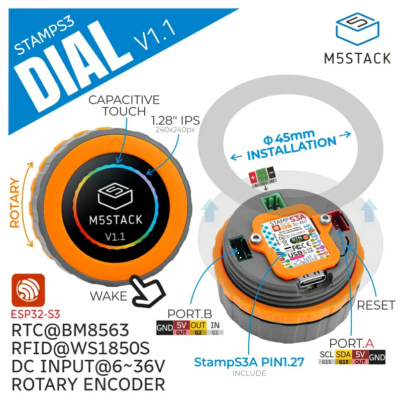
</p>

## Features

- **Watch Face**: the home screen, a cyberpunk "SCOPE" radar clock. A second-sweep hand rotates the rim once a minute with a phosphor trail, `HH:MM` sits in the centre, and turning the dial flips to a date layer (weekday, date, month progress). Press returns to the time, hold exits.
- **BLE Volume Controller**: acts as a Bluetooth HID device so the dial controls your computer's master volume. Rotate to adjust, press to mute. Mute-aware: while muted you can keep lowering the level (and drive the host all the way to 0) or rotate up to unmute.
- **Stopwatch / Timer / Pomodoro**: three time apps. The stopwatch times with centisecond precision, the countdown timer ends with a loud resonant alarm, and the pomodoro tracks focus/break cycles with session dots.
- **Set Time**: set the RTC on-device. Turn to adjust the highlighted field, press for the next field, hold to save.
- **Internet Time**: keeps the clock right over Wi-Fi (NTP). It syncs at boot and every 6 hours and shows how far the clock had drifted. Set it up from your phone by scanning the QR code on the dial.
- **Claude Usage / PC Stats**: live Claude rate-limit usage and CPU/RAM/GPU load, fed from your computer over BLE or USB (`tools/claude_sender.py`, `tools/sysstat_sender.py`).
- **Brightness Control**: adjust screen brightness as a clean 0–100 % (persisted to NVS, restored on boot).
- **More menu**: extra apps, including LCD test, RTC clock, Set Time, Internet Time, RFID scanner, WiFi scanner, BLE heart-rate server, temperature demo, deep sleep, and power off.
- **Neon-cyberpunk UI**: an electric-yellow / cyan / red palette on near-black, segmented neon gauges, 7-segment readouts, a "decrypt" boot-in animation on the time apps, and cyberpunk buzzer sound effects (sweeps and arpeggios rather than flat beeps). Everything you need to read is set in a clean sans (DejaVu) sized for arm's length, and the launcher uses [Tabler](https://tabler.io/icons) line icons (MIT). HTML design prototypes live in [`design/`](design/).

## Screenshots

Captured straight from the device's frame buffer with `tools/dial_remote.py` (Claude Usage and PC Stats show sample data).

| Launcher | Watch Face | Date |
|:---:|:---:|:---:|
| 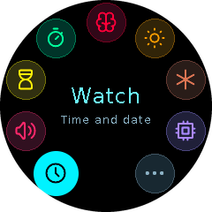 | 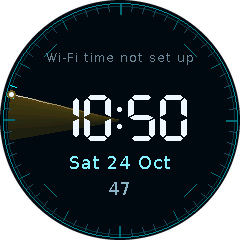 | 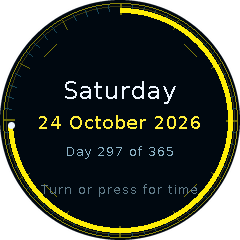 |

| Timer | Stopwatch | Pomodoro |
|:---:|:---:|:---:|
| 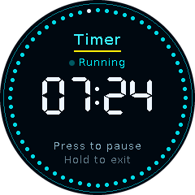 | 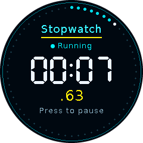 | 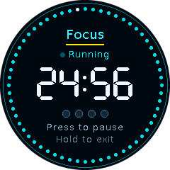 |

| Volume | Brightness | More Menu |
|:---:|:---:|:---:|
| 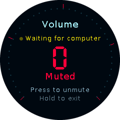 | 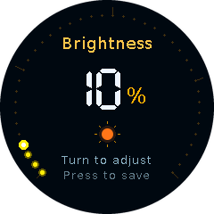 | 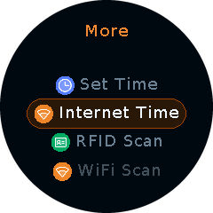 |

| Claude Usage | PC Stats | Internet Time |
|:---:|:---:|:---:|
| 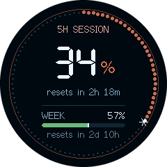 | 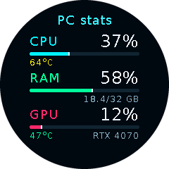 | 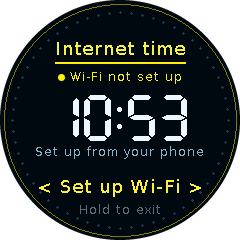 |

## 3D Printed Stand

A custom **angled desk stand with a pen holder and USB passthrough** designed for the M5Dial. Download the print files from Printables:

[M5Stack Dial Angled Desk Stand with Pen Holder & USB](https://www.printables.com/model/1758751-m5stack-dial-angled-desk-stand-with-pen-holder-usb)

<p align="center">
  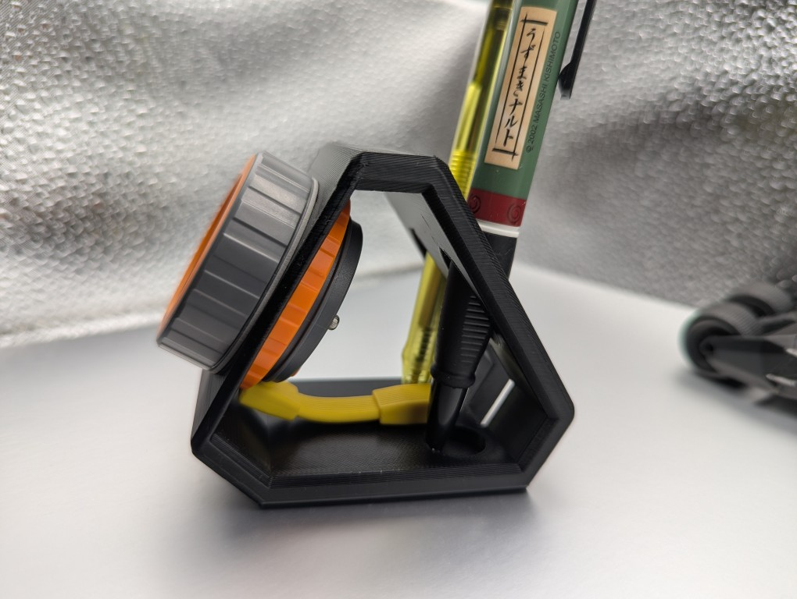
</p>

## Hardware

| Component | Detail |
|---|---|
| MCU | ESP32-S3 (M5StampS3, 8 MB flash) |
| Display | GC9A01 240×240 round SPI LCD |
| Input | Rotary encoder + push button, FT3267 capacitive touch |
| Extras | PCF8563 RTC, buzzer, WS1850S RFID |

## Getting Started

Requires [PlatformIO](https://platformio.org/).

```bash
# Build
pio run

# Build + flash to a connected M5Dial
pio run --target upload

# View serial output
pio device monitor
```

To use the **BLE Volume Controller**, open the app on the dial, then pair with `M5Dial Volume` from your computer's Bluetooth settings.

### Keeping time

The firmware seeds the RTC from the build's timestamp only if its current time is implausible, such as on a brand-new device or after a full power loss with no backup battery. Once the RTC holds a plausible time, reflashing never overwrites it, including reflashing a newer build. You can fine-tune it any time in **Set Time**, or let **Internet Time** do it for you:

1. Open **More → Internet Time** and press **Set up Wi-Fi**.
2. Scan the QR code with your phone (or join the `M5Dial-Setup` network). The setup page opens by itself; if it doesn't, browse to `192.168.4.1`.

   

3. Pick your network, enter the password, check the time zone (it's preselected from your phone), and save.

The dial then syncs at boot and every 6 hours, turning Wi-Fi off in between. The watch face shows when it last synced, and Internet Time shows how fast or slow the clock runs. It shows "Clock had lost power" instead if the RTC's oscillator stopped (its supply dropped too low), which makes a clock look like it "fell behind".

The RTC (PCF8563) draws its power straight from the `VBAT_IN` rail, the same rail as the board's LiPo battery input, with **no separate backup cell fitted by default**, so unplugging external power drops that rail to 0V and the clock resets. To retain time while unplugged, plug a small 3.7V single-cell LiPo (JST-1.25 2-pin, matching the socket's polarity marking) into the Dial's onboard battery socket. The onboard charge circuit tops it off whenever USB/DC power is present, and at ~1.9µA sleep draw even a small cell lasts a long time just holding up the RTC.

### Deep Sleep vs. Power Off

The More Menu's **Deep Sleep** item blanks the screen and drops into a low-power ESP32 deep sleep, on battery or USB/DC alike. Tap the touchscreen to wake it. Waking is a full reboot, and the watch face reappears with the correct time, since the RTC keeps running throughout regardless of what the rest of the board is doing.

**Power Off** tries to genuinely cut all power (for the lowest possible draw) and only falls back to the same deep sleep as Deep Sleep when that's not possible, i.e. when it's plugged into USB/DC, where software can't cut power on this board. **On battery alone, Power Off is a one-way trip**: once power is actually cut, neither tapping the screen nor pressing the physical button brings it back. Only reconnecting USB/DC does. Stick to Deep Sleep unless you specifically want that lower-draw, USB-recoverable-only state.

## Project Structure

```
src/
├── main.cpp            # Arduino setup()/loop() entry point
├── hal/                # Hardware abstraction layer (display, touch, encoder, RTC, buzzer)
└── apps/               # MOONCAKE app framework: launcher + individual apps
```

## Credits

Based on M5Stack's [M5Dial-UserDemo](https://github.com/m5stack/M5Dial-UserDemo) and the [MOONCAKE](https://github.com/Forairaaaaa/mooncake) app framework by Forairaaaaa.
